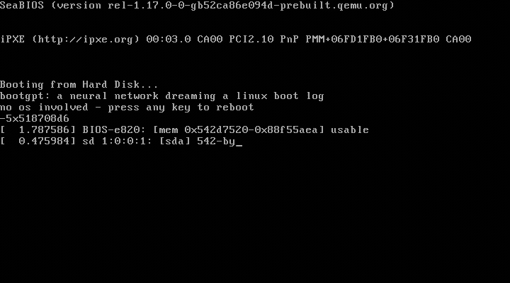

# bootgpt

A neural network that boots your PC.

The MBR is 512 bytes of hand written asm. It loads an 11.5 KB int8 model
from the next 23 sectors and runs it in 16-bit real mode on a 386. No OS,
no C runtime, nothing. The machine wakes up and dreams a Linux boot log:
timestamps, PCI bars, ACPI events for hardware that never existed.



Build thread: https://x.com/krlntn/status/2116514628457185757

With 8 chars of context and one hidden layer this is roughly the quality
you get:

```
[  2.283888] pci 0000:01:01.4: [1b36:0a35] ryndrde c4128 6422 Vveine
[  1.953886] pci 0000:01:1f.2: reg 0x10: [mem 0x7e4515e5-0x2d766c27] usbbore: reg
[  0.206596] Command line: BOOT_IMAGE=/vmlinu -5.5.2-1-generic gcc version 13.3.0, GNU ld ...
[  1.815765] ACPI: PCI Interrupt Link [LNKA: v/s.xos212
[  1.883084] NET: Registered protocol family 16
```

## Run it

```
brew install nasm qemu
python3 -m venv .venv && .venv/bin/pip install numpy
./build.sh
./run.sh
```

disk.img is a normal boot image. dd it to a USB stick and boot any BIOS
box if you have one. It only reads its own sectors.

## Pieces

`corpus_gen.py` makes 3 MB of fake dmesg. One kernel version and one disk
per boot session, because real boot logs repeat themselves and that
repetition is what makes a tiny model look sane.

`train.py` trains the model (char embeddings, one hidden layer, softmax)
and quantizes everything to int8 with power-of-two scales, so the boot
sector can do the whole forward pass with imul and a single idiv. The
script also simulates the exact integer math the asm will run, LCG
sampler included, so the Python output and the boot sector output can be
diffed. They match char for char.

`boot.asm` is the entire runtime: int 13h to load weights, int 10h to
print, a softclip activation done with cdq/idiv, argmax sampling with
timer seeded noise. Any keypress reboots the machine.

`record.py` records the demo gif from headless QEMU through the monitor
socket. No window involved.

The boot sector is code only. Strings, weights and the vocab table all
live in the data sectors, it was the only way to fit inference plus BIOS
plumbing into 510 bytes.

## Prior art

The boot sector genre is old and glorious. Oscar Toledo put
[chess](https://github.com/nanochess/Toledo-Atomchess), a whole
[OS](https://github.com/nanochess/bootOS) and even a
[BASIC interpreter](https://github.com/nanochess/bootBASIC) in there,
other people did a [C compiler](https://github.com/xorvoid/sectorc),
all inside 512 bytes. His book on boot sector games is a good read.

The closest neighbor is [sectorllm](https://github.com/rdmsr/sectorllm),
which boots a real llama2 transformer (5 layers, attention, the works)
from about 1.2 KB of real mode asm, running Karpathy's stories260K
model. [sectorlisp-nn](https://github.com/woodrush/sectorlisp-nn) runs
a TensorFlow-trained network during boot on a Lisp interpreter, and
there are UEFI apps that boot straight into llama-class models on
modern hardware.

bootgpt takes the other extreme: the whole engine fits in the 510-byte
MBR itself, weights and strings live in the following sectors, and the
model is not a general story teller but a tiny char-level net trained
for exactly one thing, hallucinating the boot log of the machine it
wakes up on.
